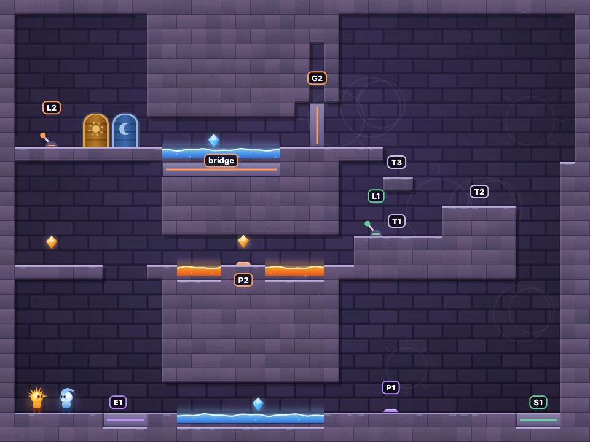
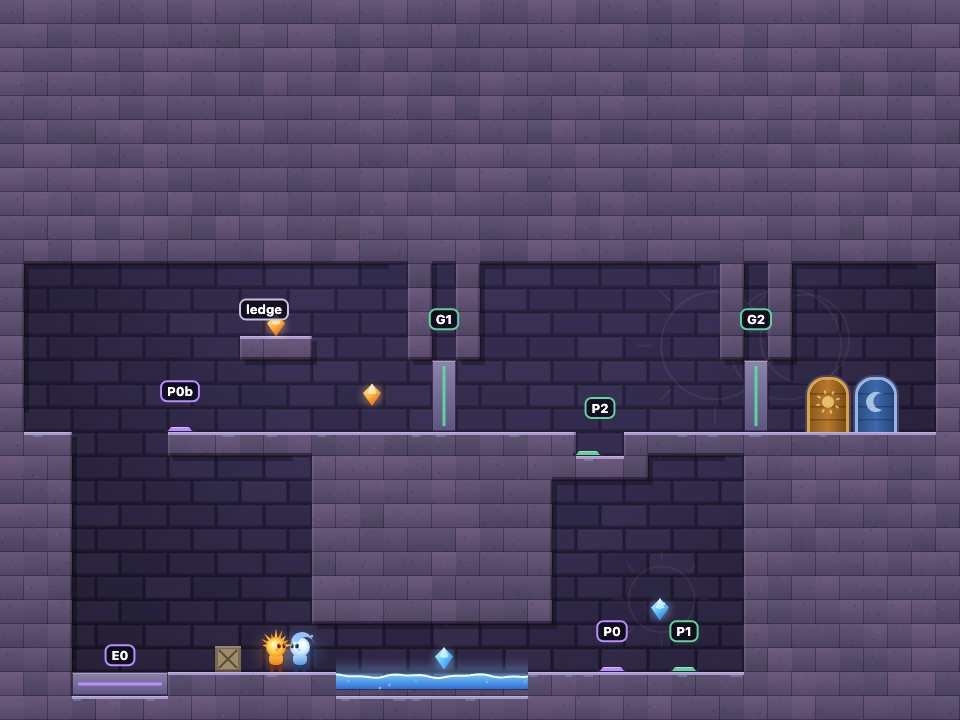
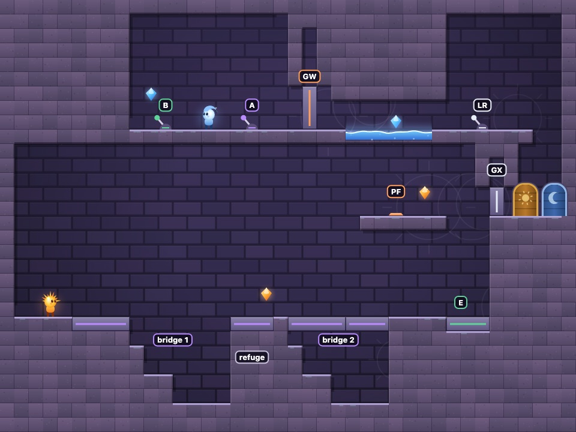
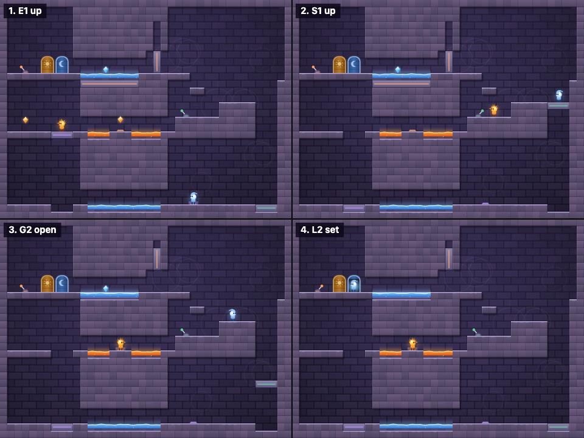
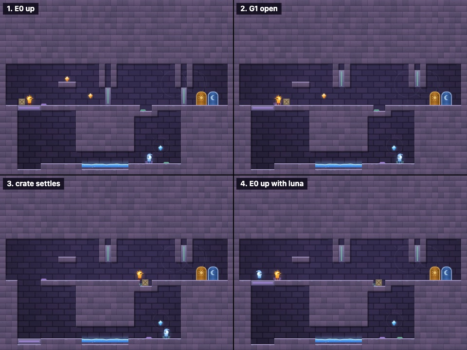
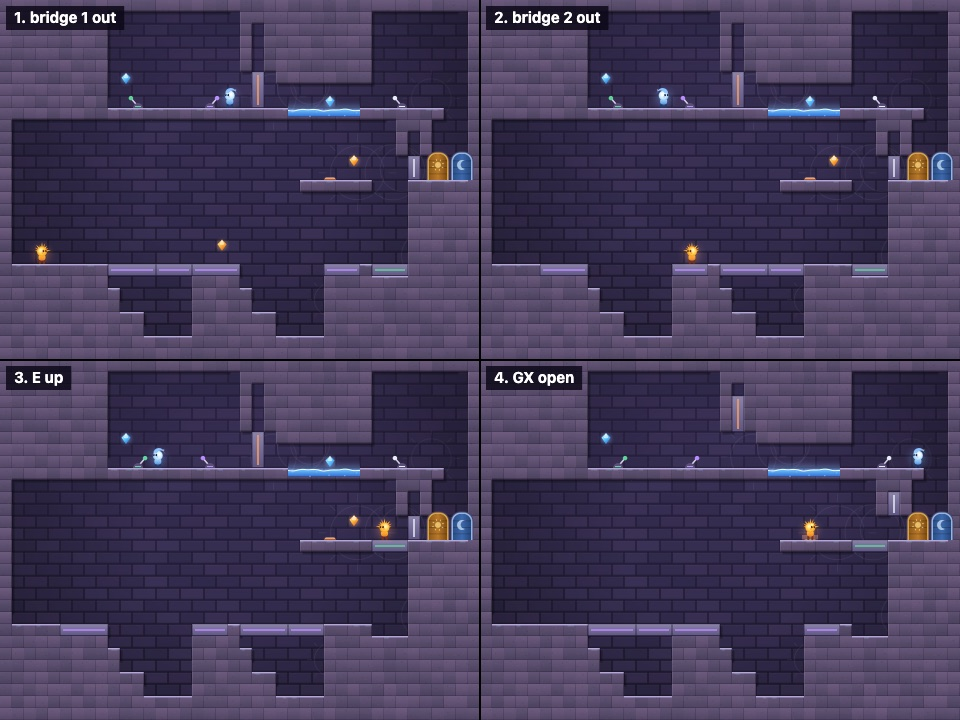

# Level design: audit and three co-op rooms

This report covers the first pass of the level-design brief ("the current levels are much too simple"). It has four parts: an audit of the 32 levels, the measured movement limits, three new rooms that replace levels 14, 19 and 26, and what is still unverified.

The brief's core rule is that each character should change what the other can do next. Every new room is built and tested against that rule.

Groups are the mechanism colours: 0 purple, 1 green, 2 orange, 3 white.

## 1. Why the old levels felt simple

The checker gained a mode where the partner can't help (`HELP=none`). Plates, levers and crates work for real, but only the one character can use them. If a character still reaches their door, the level is two solo runs side by side.

```bash
HELP=none node tools/check-levels.js 1,2,3
```

**Result: in 19 of the 32 levels, each character can finish alone.** Those levels were 1-7, 9, 11, 14, 16, 18, 19, 22, 23, 25, 26, 30 and 31. Some of them are fine as movement or tutorial rooms (1-3, 9, 11, 16, 23). The rest are meant to be co-op and aren't.

Two concrete examples:

- **Level 4, Hold the Gate.** The hint says plates only work while something stands on them, so it reads as "one holds, one passes". There is a plate on each side of the gate, though. The checker's route has Sol stand on the near plate until the gate is open, then run through it alone. The gate is 6 tiles tall and closes at 1.6 px per tick, which takes 1.5 s. Sol covers that distance in under 1 s.
- **Old level 26, Pressure Points.** Both floor gates have a plate on each side, so each player opens their own way. The final pair of counterweight lifts is driven by a plate next to the bottom lift. The checker's route has Sol work that plate himself and ride the lift up.

These three causes repeat across the 19 levels:

1. **A control on each side of an obstacle.** Each player serves themselves. Gatekeepers (old 19) states it in its hint: "Plates on both sides of every gate."
2. **Mechanisms move slower than players run.** Platforms move at 1.6 px per tick (0.25 s per tile), and players run at 3.25 px per tick. Stepping off a plate and racing the closing gate usually works.
3. **The control sits next to what it moves**, so the "helper" is also the traveller. Lift Relay (old 14) has a lever at both ends of every lift.

The other 13 levels need the partner at least once. I didn't analyse them further. Even there the help is usually a single favour, and nobody has to rescue the helper afterwards.

## 2. Movement limits

`node tools/calibrate.js` measures these numbers with the real simulation in small test rooms. H is the player's height (34 px), and a tile is 24 px.

| Measure | Value |
| --- | --- |
| Run speed | 3.25 px/tick = 5.74 H/s, full speed after 0.12 s |
| Stopping | 0.10 s, slides 7 px |
| Jump height | 77 px = 3.2 tiles = 2.26 H |
| Time to the top of the jump | 0.32 s |
| Running jump | 0.65 s in the air, 5.3 tiles |
| Tallest ledge climbed | 3 tiles |
| Widest gap, same height | 6 tiles |
| Widest gap, landing 2 tiles higher | 5 tiles |
| Widest gap, landing 2 or more tiles lower | 7 tiles |
| Lifts, gates, bridges | 1.6 px/tick = 0.25 s per tile |

**Physics changes: none.** The jump is a little higher and quicker than the brief's starting proposal (2 H in 0.38 s), but nothing measured shows a problem with it. The race against slow gates is a real problem, and the new rooms design around it instead of changing a global speed that 29 other levels depend on.

Budgets used in the new rooms:

- Every required climb is 2 tiles (62% of the maximum), with nothing overhead at the take-off point.
- Gaps meant to be crossed are 1 to 2 tiles.
- Gaps meant to block are 7 tiles or more at the same height.
- A character-only route is a pool under a low ceiling with 2 tiles of headroom. The jump then rises only about 14 px, so neither character can jump the pool, and only its own character can wade it.

## 3. The three rooms

Each room replaces a level from the audit that one player could finish alone. The new rooms are 14 Helper's Way Out (replacing Lift Relay), 19 Carry the Weight (replacing Gatekeepers) and 26 Operator (replacing Pressure Points). They are original layouts built from the brief's blueprints 1-3, and none of them copies a room from the reference game.

### Level 14, Helper's Way Out



**Central question:** whoever holds a plate is stuck there, so how does the other player get them out?

| ID | Mechanism | Who can reach it | Effect |
| --- | --- | --- | --- |
| P1 | Plate past a low moon channel (bottom right) | Luna | Raises lift E1 while held |
| E1 | Lift at the start | Sol | Carries him to the middle floor |
| L1 | Lever on step T1 | Sol | Raises lift S1 and keeps it up |
| S1 | Lift in the right-hand shaft | Luna | Carries her from P1's room to step T2 |
| P2 | Plate on an island in a low sun corridor | Sol | Opens G2 and raises the bridge while held |
| G2 | Gate on the top floor | | Keeps Luna out of the moon gallery |
| bridge | Flush over the top moon pool | | Lets Sol cross to the exits |
| L2 | Lever in the far corner, past both doors | Luna | Same group as P2, so it keeps G2 open and the bridge up for good |

Intended solution:

1. Sol stands on E1. Luna wades the moon channel and holds P1, which raises E1.
2. Sol crosses the sun corridor, climbs onto step T1 and pushes L1 to the right. S1 lifts Luna to step T2.
3. Sol goes back and holds P2. That opens G2 and raises the bridge.
4. Luna climbs T2, T3 and the landing, goes through G2 and over the bridge, and runs to the corner. She pushes L2 right on her way back to her door.
5. Sol leaves P2, since L2 now holds both open. He climbs the same steps, crosses the bridge and reaches his door.

The roles swap halfway through. Luna helps first and Sol rescues her. Then Sol helps and Luna rescues him.

Alternatives and recovery:

- If Sol flips L1 before Luna is on S1, the lift goes up empty. He pushes L1 left and it comes back down.
- Walking left over L1 later lowers S1. That's harmless once Luna is off it.
- L2 sits at a dead end on the left. Luna arrives moving left, which leaves it off, then turns right, which flips it on, and keeps walking toward her door. Her route never takes her back over it.
- Sol can fall into Luna's shaft from step T2 before L1 is set. That traps him, and R restarts the level.

### Level 19, Carry the Weight



**Central question:** where must the crate end up?

| ID | Mechanism | Who can reach it | Effect |
| --- | --- | --- | --- |
| P0 | Plate past a low moon tunnel (bottom) | Luna | Raises the wide lift E0 |
| E0 | Lift against the left wall | Sol and the crate, later Luna | Carries them to the upper floor |
| P0b | Plate beside the top of E0 | Whoever is up | Raises E0 for the partner below |
| P1 | Plate next to P0 | Luna | Opens G1 and G2 while held |
| P2 | Plate at the bottom of a 1-tile socket | The crate | Same group as P1, so it holds both gates open |
| ledge | High ledge above the floor | Only from on top of the crate | Mastery gem |

Intended solution:

1. Sol pushes the crate left onto E0, where the wall stops it, and stays on the lift. Luna holds P0, and both of them ride up.
2. Sol hops over the crate and pushes it off the lift. As an optional extra, he can stand on the crate to reach the ledge gem.
3. Luna moves to P1, which opens G1. Sol pushes the crate through G1 into the socket on P2, and the crate now holds both gates open.
4. Luna walks back to E0, which is down. Sol stands on P0b, which lifts her up.
5. Both walk through the gates to the exits.

Why the crate is required: at the end both players are standing at their doors, and G2 only opens while something is on P1 or P2. P1 is down in Luna's tunnel room. I tested whether Sol could hold P2 himself, wait for Luna to finish, then race out. He gets to x = 30.58, and the closing gate is at x = 31.

Recovery:

- If the crate is left on E0 when the lift drops, it rides back down. Luna holds P0 again to bring it up.
- A crate pushed into the moon tunnel can't come out, because crates can't step up. That needs R.
- Walking over the socket drops a player into the 22 px gap beside the crate. One hop gets them out.

### Level 26, Operator



**Central question:** which bridge arrangement lets the runner reach the next safe spot?

| ID | Mechanism | Who can reach it | Effect |
| --- | --- | --- | --- |
| A | Lever on Luna's deck | Luna | On: bridge 1 out, bridge 2 in. Off: the reverse. Never both out. |
| B | Lever on the deck | Luna | Sends lift E up to the plate landing and keeps it there |
| PF | Plate on the plate landing | Sol | Opens GW while held |
| GW | Gate at the end of the deck | | Luna's way into the moon gallery |
| LR | Lever in the gallery | Luna | Opens GX for good |
| GX | Gate in front of the exits | | Sol's last barrier |

The bridges are two halves each, and they slide into the blocks on either side. A retracted bridge leaves nothing behind to jump on. The pits are not deadly. Each pit has a 2-tile stair back up to the block the runner came from, so a fall costs only time.

Intended solution:

1. Luna pushes A on. Bridge 1 comes out, and Sol crosses to the refuge.
2. Luna pushes A off. Bridge 2 comes out, and Sol crosses to lift E.
3. Luna walks to the left end of the deck, then pushes B on. E lifts Sol to the plate landing.
4. Sol holds PF, which opens GW. Luna goes through the gallery and pushes LR on, which opens GX. She drops through the hole to her door.
5. Sol leaves PF and goes through GX to his door.

Luna starts between B and A, and the levers are placed so that any accidental flip happens after it stops mattering. For example, walking to GW flips A on again, but by then Sol is already up on E.

### What each room's dependency checks prove

`node tools/check-deps.js` runs the checker with the partner allowed to flip only some groups. A "door n" result proves the missing help is required.

| Room | Character | Partner may flip | Door | Meaning |
| --- | --- | --- | --- | --- |
| 14 | Sol / Luna | nothing | n / n | Neither can finish alone |
| 14 | Sol | 0 (P1) | n | Being lifted isn't enough; he needs L2 |
| 14 | Sol | 0, 2 (P1, L2) | Y | That is exactly the help he needs |
| 14 | Luna | 1 (L1) | n | She also needs Sol on P2 |
| 14 | Luna | 1, 2 (L1, P2) | Y | |
| 19 | Sol | nothing / 0 | n / n | He needs P0 and the gates |
| 19 | Sol | 0, 1 | Y | |
| 19 | Luna | 0 / 1 | n / n | She needs both the lift and the gates |
| 19 | Luna | 0, 1 | Y | |
| 26 | Luna | nothing / 2 (PF) | n / Y | She needs only Sol on PF |
| 26 | Sol | 0, 1 (A, B) | n | The levers alone don't get him out |
| 26 | Sol | 0, 1, 2 | n | He needs LR, not PF |
| 26 | Sol | 0, 1, 3 (A, B, LR) | Y | |
| 26 | Sol | 1, 3 or 0, 3 | n | He needs both A and B |

### How each room plays out

`node tools/coop-bot.js 14,19,26` plays each room with two scripted players:

| Room | Result |
| --- | --- |
| 14 | Won in 29.3 s, 4 of 4 gems |
| 19 | Won in 29.5 s, 3 of 4 gems (the bot skips a floating gem) |
| 26 | Won in 15.4 s, 3 of 4 gems |

The solo checker confirms every gem in all three rooms can be reached.

Four moments from each bot run:





## 4. Not verified

- **No fresh player has tried these rooms.** Every result here comes from the checker and the scripted bot. That proves the rooms are solvable and that the dependencies hold. It doesn't prove that a first-time player can work out what to do, or which links read clearly. That is the most important next step.
- **Links rely on colour.** Mechanisms match by group colour only. The brief suggests adding a symbol or a wire as well.
- **Mobile touch controls on these rooms** haven't been tried.
- **The other 16 solo-finishable levels** are unchanged. The audit list above is the work queue. Gate placement and plate pairs are the first things to fix.

## 5. Tools added

| Command | What it does |
| --- | --- |
| `HELP=none node tools/check-levels.js N` | Can one character finish level N with no help at all? |
| `HELP=0,2 WHO=sol node tools/check-levels.js N` | The same, with the partner allowed to flip only groups 0 and 2 |
| `node tools/check-deps.js` | The dependency table above, as a regression test |
| `node tools/calibrate.js` | The movement-limits table |
| `./tools/capture.sh` | Re-renders the images in `docs/img` with headless Chrome |
| `./tools/check-all.sh` | Solo checker, co-op bot and dependency checks together |
